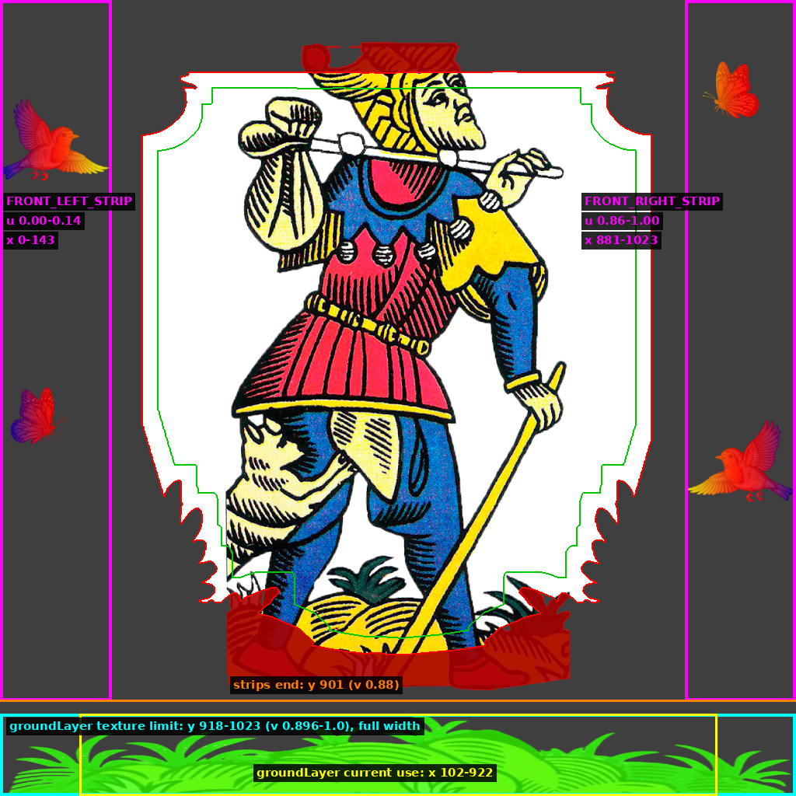

# Foil Card

A 3D collectible card with foil effects, written in C with [raylib](https://www.raylib.com/) and a single GLSL 330 fragment shader.

The card follows the mouse, can be flipped, and changes its look with its rarity. The birds and butterflies on the sides pop out of the card and move with parallax.

## Controls

- **Mouse**: tilt the card
- **R**: cycle rarity
- **Checkboxes**: toggle each effect

## Effects

- **Aura**: pulsing glow around the card
- **Sparkles**: glints on the front and twinkling stars on the back
- **Holo**: holographic pattern that shifts with the tilt
- **Rim**: prismatic border
- **Flip**: turns the card to show its back
- **Burn**: burns the card away
- **Glare**: mirror-like reflection

## Rarities

| Rarity    | Effects                          |
|-----------|----------------------------------|
| Normal    | none                             |
| Rare      | Sparkles, Holo                   |
| Epic      | Aura, Sparkles, Holo, Rim        |
| Legendary | Aura, Sparkles, Holo, Rim, Glare |

## Build

```sh
gcc main.c -o foil_card -lraylib -lm
```

On Linux you may also need `-lGL -lpthread -ldl -lrt -lX11`.

The executable loads its assets from a `data/` folder next to it:

```
foil_card
data/
├── foil.fs
├── frame.png
├── background.jpg
├── character.png
├── mask.jpg
└── back.png
```

## Character texture

`character.png` is used in three ways, shown below:

- The central figure is drawn on the card face.
- The two side strips (magenta) hold the birds and butterflies. They are drawn as separate quads in front of the card, so they appear to float above it.
- The bottom band (cyan) is the grass, sampled by `groundLayer` in the shader.


